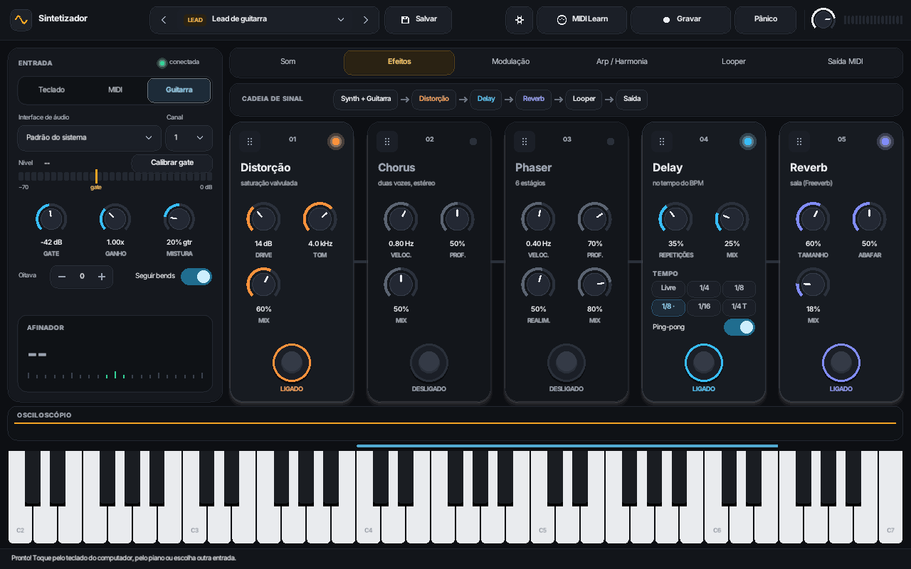
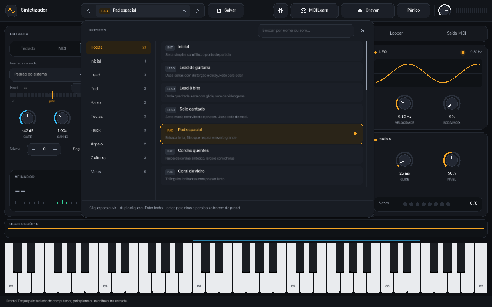
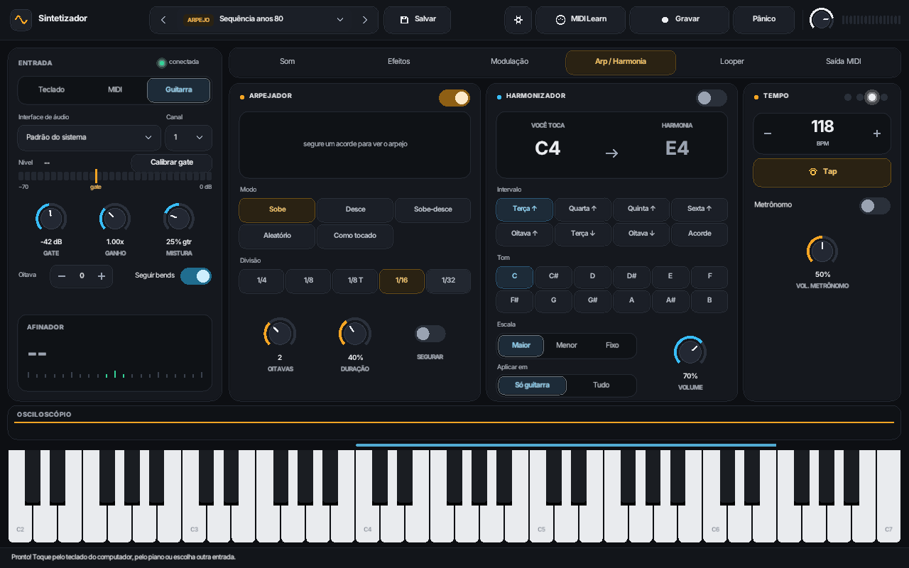

# Virtual Synth

Sintetizador em C.



Sintetizador com interface gráfica que você toca pelo **teclado do computador**,
pelo **piano na tela**, por um **teclado/controlador MIDI** ou por uma
**guitarra/microfone** (o programa descobre a nota que você está tocando).

- **Som:** 2 osciladores, filtro com ressonância, 2 envelopes, LFO, 8 vozes
- **Modulação:** 6 "cabos" que ligam fontes (LFO, envelope, velocity, roda de mod.,
  intensidade da guitarra) a destinos (altura, filtro, volume, mistura)
- **Efeitos:** distorção, chorus, phaser, delay (livre ou no BPM, ping-pong) e
  reverb. Liga/desliga e ordem ajustáveis
- **Arpejador:** 5 modos, 1/4 a 1/32, até 4 oitavas, "segurar"
- **Harmonizador:** acrescenta terça, quinta, oitava ou um acorde, seguindo o
  tom e a escala (ou intervalo fixo). A voz extra acompanha os bends da guitarra
- **Guitarra → MIDI:** as notas detectadas saem como MIDI (com pitch bend) para
  Reaper, Ableton, FL Studio etc. A guitarra passa a tocar qualquer instrumento virtual
- **Looper:** grava, repete, grava por cima e desfaz (até 60 s), com metrônomo
- **Presets:** 21 de fábrica em 8 categorias (Lead, Pad, Baixo, Teclas, Pluck,
  Arpejo, Guitarra) mais os seus, com navegador e busca
- **Mais:** gravação em WAV, afinador, osciloscópio, MIDI learn, pedal de
  sustain, tap tempo, tela cheia (F1), dicas em todos os controles e as
  configurações lembradas entre uma sessão e outra
- **Pouco atraso:** detecção da guitarra em 12–17 ms, buffer ajustável, modo
  exclusivo (WASAPI), drivers ASIO no Windows e um medidor de latência real

## Compilar

O projeto usa CMake. Na primeira compilação ele **baixa sozinho** o raylib
(janela), o miniaudio (áudio) e o PortMidi (MIDI) e, no Windows, também o
PortAudio e o SDK ASIO. É preciso estar conectado à internet. A fonte Inter já
vem no repositório e fica embutida no executável.

### Linux (Ubuntu/Debian)
```sh
sudo apt install build-essential cmake git libasound2-dev libx11-dev libxrandr-dev \
                 libxinerama-dev libxcursor-dev libxi-dev libgl1-mesa-dev
cmake -B build
cmake --build build -j
./build/synth
```

### macOS
```sh
xcode-select --install
brew install cmake
cmake -B build
cmake --build build -j
./build/synth
```

### Windows
Use o **MSYS2** (https://www.msys2.org). Abra o terminal "MSYS2 UCRT64" e rode:
```sh
pacman -S --needed mingw-w64-ucrt-x86_64-gcc mingw-w64-ucrt-x86_64-cmake git make
cmake -B build -G "MSYS Makefiles"
cmake --build build -j
./build/synth.exe
```
O `synth.exe` já sai com tudo embutido: dá para copiar para outro computador.
O Visual Studio (MSVC) não é suportado, porque o código usa `pthread` e
atômicos do C11.

Sem MIDI: `cmake -B build -DSYNTH_MIDI=OFF`.

**ASIO (menos atraso no Windows).** O build do Windows já vem com suporte
aos drivers ASIO das interfaces de áudio. Na engrenagem (Configurações de
áudio), escolha a saída `ASIO: nome da sua interface`: a entrada da
guitarra passa a vir do mesmo driver, e o botão **Painel do driver** abre o
painel do fabricante. Se o driver recusar 48000 Hz, mude a taxa nesse
painel. O SDK ASIO 2.3 da Steinberg é baixado sozinho na configuração (do
espelho `jcelerier/asio-2`); para usar o ZIP oficial já extraído:
`cmake -B build -DASIOSDK_DIR=C:/caminho/asiosdk`. Sem ASIO:
`-DSYNTH_ASIO=OFF`.

## Como usar

### 1. Escolha a entrada (painel da esquerda)

| Entrada | O que fazer |
|---|---|
| **Teclado** | Toque nas duas fileiras de letras (o desenho mostra quais são as teclas). Setas ←/→ mudam a oitava, **Espaço** é o pedal de sustain. O teclado do computador e o piano funcionam em qualquer modo. |
| **MIDI** | Escolha o dispositivo na lista. Se você o ligou com o programa aberto, clique em **Atualizar**. Pitch bend, roda de modulação e pedal já funcionam. |
| **Guitarra** | Escolha a entrada de áudio (de preferência uma interface de áudio) e o canal. Clique em **Calibrar gate** e deixe as cordas abafadas por 3 segundos: o gate (traço laranja) fica logo acima do ruído. Também dá para ajustar o knob **Gate** à mão. |

Painel da guitarra:
- **Mistura:** mistura o som limpo da guitarra com o synth. "Só synth" deixa só o sintetizador.
- **Oitava:** toca o synth 1 ou 2 oitavas acima ou abaixo (ótimo para fazer baixo).
- **Seguir bends:** o synth acompanha bends e vibrato.
- **Afinador:** fica verde quando a corda está afinada.

Dicas para a guitarra: toque **uma nota por vez** (a detecção é monofônica),
abafe as outras cordas e prefira o captador do braço. Uma palhetada nova
reinicia a nota; hammer-on e slide deslizam até a nota seguinte.

Atraso entre a palhetada e o som, só da detecção (medido nos testes):

| Notas | Primeira versão | Agora |
|---|---|---|
| Ré do drop-D | 33–39 ms | 28 ms |
| Cordas Mi, Lá e Ré soltas (graves) | 33–39 ms | 17 ms |
| Da corda Sol para cima | 28–39 ms | 12 ms |

O detector usa três janelas de análise: curta (11 ms) para as notas a partir
de 180 Hz, média (17 ms) para os graves e longa (27 ms) só para o Ré do
drop-D. Quando a leitura é muito confiável, a nota sai sem esperar a segunda
análise. A isso se soma o atraso da placa de som (veja abaixo).

#### Diminuir o atraso da placa de som

Na **engrenagem** da barra de cima (Configurações de áudio):
- **Tamanho do buffer:** 64 ou 128 amostras dão menos atraso. Se aparecerem
  estalos, aumente.
- **Modo exclusivo (Windows):** o programa usa a placa sozinho (WASAPI).
- **ASIO (Windows):** com uma interface de áudio, escolha a saída `ASIO: ...`.
  Costuma ser o caminho de menor atraso.
- **Medir a latência real:** ligue um cabo da saída na entrada da interface
  (ou encoste o microfone no alto-falante) e clique em **Medir**. O programa
  toca 5 cliques, ouve cada um voltar e mostra a mediana do tempo de ida e volta.

### 2. Ajuste o som (abas)

- **Som:** formas de onda, filtro, envelopes e LFO.
- **Efeitos:** marque a caixinha para ligar. As setas ▲▼ mudam a ordem; a linha
  "Cadeia" mostra o caminho do som. "Tempo" do delay em 1/8, 1/16... segue o BPM.
- **Modulação:** cada linha é um cabo. Exemplo: *Fonte* LFO, *Via* Roda mod.,
  *Destino* Altura = vibrato que aparece quando você gira a roda.
- **Arp/Harmonia:** ligue o arpejador e segure um acorde. No **Harmonizador**,
  escolha o intervalo, o tom e a escala da música. "Aplicar em: Só guitarra"
  deixa o teclado como está; "Tudo" harmoniza qualquer entrada.
- **Looper:** "Gravar" → toque → "Fechar o loop" → "Gravar por cima"...
  A tecla **Enter** aperta o botão grande, para não precisar soltar a guitarra.

- **Saída MIDI:** em "Enviar", escolha **Guitarra** (só a nota tocada, com
  bends) ou **Tudo** (também teclado, harmonia e arpejo). Depois escolha o
  destino:
  - **Linux e macOS:** use "Porta virtual \"Sintetizador\"". Ela aparece
    sozinha como entrada MIDI na DAW.
  - **Windows:** instale o **loopMIDI** (gratuito), crie uma porta, clique em
    Atualizar e escolha-a aqui e na DAW.

  Ajuste a faixa de pitch bend do instrumento na DAW para o mesmo valor
  daqui (padrão 2). Para ouvir só a DAW, deixe a Mistura em "só gtr" ou o
  Nível do synth em 0.

### 3. Barra de cima

- **Preset:** as setas ‹ › passam de um preset para o outro. Clique no nome
  para abrir o **navegador**: categorias à esquerda, busca por nome ou som
  ("delay", "vibrato"...), clique para ouvir e duplo clique ou Enter para
  fechar. As setas ↑ ↓ do teclado também trocam de preset.
- **Salvar:** dê um nome, escolha a categoria e aperte Enter. O preset vai para
  a pasta `presets/` e aparece no navegador. Presets não mudam a entrada, o
  gate nem o volume geral.
- **MIDI Learn:** ligue, clique num controle (fica com contorno laranja) e gire
  um knob do seu controlador; pronto, ele passa a controlar aquele item.
  Botão direito desfaz. O mapa fica salvo em `midi-learn.txt`.
- **Gravar WAV:** grava tudo o que sai (sem o metrônomo) em `gravacoes/`.
- **Pânico:** silencia todas as notas e para o looper.

Pare o mouse em cima de qualquer controle para ver o que ele faz. O programa
lembra a entrada, os dispositivos, o buffer, o preset e todos os ajustes em
`configuracoes.ini`.

| | |
|---|---|
|  |  |
|  |  |

## Organização do código

```
src/
  main.c        início do programa e opções de linha de comando
  gui.c         telas, janelas e configurações lembradas
  ui.c          widgets desenhados à mão (knobs, botões, listas, dicas)
  audio_asio.c  drivers ASIO no Windows (PortAudio + SDK ASIO)
  engine.c      motor de áudio: caminho das notas (oitava -> harmonizador ->
                arpejador -> synth/saída MIDI), mixagem, metrônomo, dispositivos
  params.c      tabela de todos os parâmetros, presets
  synth.c       vozes, osciladores, filtro, envelopes, matriz de modulação
  fx.c          distorção, chorus, phaser, delay, reverb (Freeverb)
  arp.c         arpejador
  looper.c      looper com overdub e desfazer
  pitch.c       detecção de altura (YIN) e seguidor de notas
  guitar.c      thread que analisa a entrada de áudio
  midi.c        PortMidi: entrada, saída (guitarra -> MIDI) e MIDI learn
  recorder.c    gravação WAV
  queue.h       filas sem trava entre as threads e o áudio
tests/
  test_dsp.c        testes que rodam sem placa de som
  test_midi_out.c   bytes da saída MIDI, com um PortMidi falso
```

Regras que mantêm o som sem estalos:
- O callback de áudio **nunca espera**: não usa mutex, malloc nem acesso a disco.
- Os **parâmetros são suavizados** (~30 ms): girar um knob rápido não gera
  "zíper".
- **Denormais** (números minúsculos no fim de um reverb, que deixam a CPU
  até 9x mais lenta) são tratados como zero (FTZ/DAZ).
- Interface, MIDI e guitarra conversam com ele por **filas sem trava**
  (`queue.h`) e por **parâmetros atômicos** (`params.c`).
- A análise da guitarra (YIN, ~4% de um núcleo) roda numa thread própria; o
  callback só copia as amostras.

Para criar um novo parâmetro:
1. Acrescente o nome em `params.h`.
2. Descreva-o em `params.c`.
3. Leia o valor com `param_get()` no ponto do áudio que deve usá-lo.
4. Escreva a dica dele na tabela `HELP` de `params.c`.
5. Desenhe o controle com `ui_knob()` ou `ui_param_switch()` em `gui.c`.

Com isso ele já funciona automaticamente com presets e MIDI learn.

## Testes

```sh
cmake --build build && ./build/test_dsp && ./build/test_midi_out
```

Os testes:
- simulam cordas de guitarra (Karplus-Strong) e conferem as notas detectadas:
  da afinação drop-D ao Mi agudo, a escala cromática com 5 ruídos diferentes,
  riffs, saltos de oitava e a mesma nota palhetada várias vezes;
- verificam que os efeitos não ficam instáveis, nem com todos os botões no máximo;
- conferem o tempo do arpejador e o overdub/desfazer do looper;
- testam o harmonizador (incluindo bends) e a sequência enviada para a DAW;
- medem a suavização dos knobs e o ganho da proteção contra denormais;
- salvam e carregam presets;
- medem a latência com um "cabo" simulado da saída na entrada;
- geram `demo.wav` com o motor completo.

Para testar a interface sem placa de som: `./build/synth --null-audio`.
Para gerar uma captura da tela: `--screenshot tela.png`, com `--tab N`,
`--mode N` e `--preset N` para escolher o que aparece.

## Licença

GPLv3 (arquivo `LICENSE`). O suporte a ASIO usa o SDK ASIO da Steinberg na
opção de licença GPLv3, o que exige que o programa inteiro também seja GPLv3.
ASIO é marca registrada da Steinberg Media Technologies GmbH.
A fonte Inter usa a licença SIL Open Font License (`assets/fonts/OFL-Inter.txt`).
