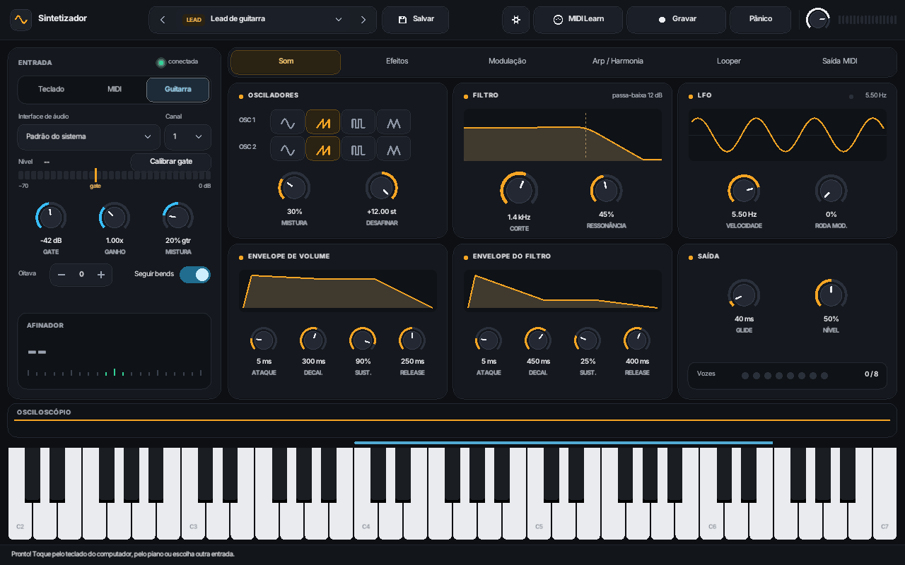
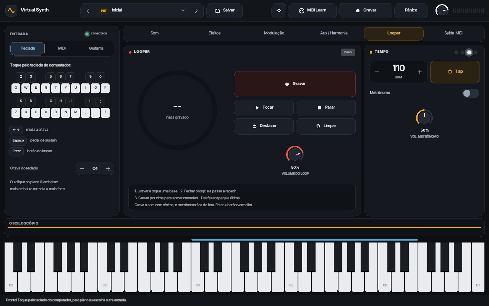

# Virtual Synth

A synthesizer written in C that you can play with your **computer keyboard**,
the **on-screen piano**, a **MIDI keyboard/controller** or a
**guitar/microphone**.


> The app's interface is in Brazilian Portuguese. In this README, on-screen
> labels are shown as they appear in the app, with a translation, e.g.
> **Gravar** (Record).

## Download

No compiling or terminal needed: download, unzip and open.

| System | Download |
|---|---|
| **Windows** 10/11 (64-bit) | [VirtualSynth-Windows.zip](https://github.com/vDonasan/VSynth/releases/latest/download/VirtualSynth-Windows.zip) |
| **macOS** 11 or newer (Apple Silicon and Intel) | [VirtualSynth-macOS.zip](https://github.com/vDonasan/VSynth/releases/latest/download/VirtualSynth-macOS.zip) |
| **Linux** x86_64 | [VirtualSynth-Linux.tar.gz](https://github.com/vDonasan/VSynth/releases/latest/download/VirtualSynth-Linux.tar.gz) |

All versions: [Releases](https://github.com/vDonasan/VSynth/releases).

- **Windows:** extract the zip (right-click → *Extract All*) and open
  `VirtualSynth.exe`. The first time, if "Windows protected your PC" appears,
  click *More info* → *Run anyway* (the app is not digitally signed).
- **macOS:** drag the app to Applications. The first time, right-click it →
  *Open* → *Open*. Allow microphone access to use a guitar.
- **Linux:** open `VirtualSynth` (needs X11 or XWayland with OpenGL).

Presets, settings and recordings are kept next to the program (on macOS, in
`~/Library/Application Support/Virtual Synth`).

## Features

- **Sound:** 2 oscillators, resonant filter, 2 envelopes, LFO, 8 voices
- **Modulation:** 6 "patch cables" connecting sources (LFO, filter envelope,
  velocity, mod wheel, guitar level) to destinations (pitch, cutoff, volume,
  oscillator mix)
- **Effects:** distortion, chorus, phaser, delay (free or synced to BPM,
  ping-pong) and reverb, as a pedalboard: switch each pedal on/off and drag to
  reorder
- **Arpeggiator:** 5 modes, 1/4 to 1/32, up to 4 octaves, hold
- **Harmonizer:** adds a third, fifth, octave or a chord, following the key and
  scale (or a fixed interval). The extra voice follows guitar bends
- **Guitar, two ways:**
  - **Notes mode** recognizes each note you play. It drives the synth, the
    harmonizer and the arpeggiator, and is sent out as MIDI (with pitch bend)
    to REAPER, Ableton, FL Studio, etc.
  - **Direct mode** uses the string's own waveform as the sound source, like
    guitar synth pedals do. The only delay is the audio buffer, and there are
    no wrong notes to jump between
- **Looper:** record, loop, overdub and undo (up to 60 s), with metronome
- **Presets:** 21 factory presets in 7 categories (Lead, Pad, Bass, Keys,
  Pluck, Arpeggio, Guitar) plus your own, with a browser and search
- **More:** WAV recording, tuner, oscilloscope, MIDI learn, sustain pedal,
  tap tempo, full screen (F1), tooltips on every control, and settings
  remembered between sessions
- **Low latency:** buffers from 32 samples, exclusive mode (WASAPI), ASIO
  drivers on Windows and a real round-trip latency meter

## How to use

### 1. Choose the input (left panel)

| Input | What to do |
|---|---|
| **Teclado** (Keyboard) | Play the two rows of letter keys (the on-screen piano shows which). ←/→ change the octave, **Space** is the sustain pedal. The computer keyboard and the on-screen piano work in any mode. |
| **MIDI** | Pick the device from the list. If you plugged it in with the app open, click **Atualizar** (Refresh). Pitch bend, mod wheel and sustain pedal work out of the box. |
| **Guitarra** (Guitar) | Pick the audio input (ideally an audio interface) and the channel. Click **Calibrar gate** (Calibrate gate) and leave the guitar still for 2 seconds: the app measures your interface's noise inside the audio stream and sets the gate (orange line) 10 dB above it. You can also set the **Gate** knob by hand. |

Guitar panel:
- **Mistura** (Mix): blends the clean guitar with the synth. All the way left
  is synth only.
- **Synth: Notas | Direto** (Notes | Direct): how the synth follows the guitar
  (see below).
- **Oitava** (Octave): plays the synth 1 or 2 octaves up or down (great for
  bass lines).
- **Bends** (Notes mode): the synth follows bends and vibrato.
- **Ataque imediato** (Immediate attack, Notes mode): see below.
- **Afinador** (Tuner): turns green when the string is in tune.

#### Notes mode

Each note is recognized (pitch detection) and played on the synth. Play
**one note at a time** (detection is monophonic). Strings you let ring are
handled (see below), but muting them still gives the cleanest result; prefer
the neck pickup. A new pick restarts the note; hammer-ons and slides
glide to the next note.

Time from pick to sound, measured with a simulated guitar in the tests (not
counting the sound card):

| Notes | Note recognized | With **Ataque imediato** |
|---|---|---|
| Drop-D low D | 27 ms | sound starts at ~1 ms |
| Low E, A and D strings | 19 ms | sound starts at ~1 ms |
| G string and up | 12 ms | sound starts at ~1 ms |

For comparison, published measurements put Jam Origin MIDI Guitar at about
30 ms on low notes and hexaphonic-pickup systems (Fishman TriplePlay) at about
13 ms on the low E. Nothing that recognizes the note can go much lower: one
cycle of the low E alone lasts 12 ms.

**Ataque imediato** (Immediate attack, on by default): the sound starts as
soon as the pick is detected, muffled and at the previous note's pitch, then
snaps to the right note (filter opens, pitch jumps) when the note is
recognized. Your ear hears the sound start at the pick, so the delay feels much
shorter, especially on the low strings. A hit on the strings that doesn't turn
into a note fades out in ~30 ms. If the "click" at the start bothers you in a
preset, switch it off. It is disabled while the arpeggiator is on.

To cope with a real guitar, the detector:
- recognizes a **pick by the pick's high-frequency click** (not by level
  changes, which on a low string fluctuate all the time), and only if the
  level rises;
- reads the pitch only when the whole analysis window holds sound from after
  the pick (no leftovers of the previous note or of ringing open strings);
- allows 0.7 semitone of tolerance around the sounding note (the string starts
  slightly sharp and settles);
- changes note without a new pick (hammer-on, slide) only after 20 ms of
  consistent readings;
- treats a one-semitone change in the first 80 ms after a pick as the **same
  note being corrected** (a string arriving from a semitone below/above): it
  switches as soon as the reading is nearer the neighbour, and the synth
  glides there in 8 ms without retriggering. In the tests, time on the wrong
  note dropped from 25 ms to 3 ms;
- **starts** a note only after an attack (a pick, or sound coming out of
  silence): steady hum and noise never become notes, even with a low gate;
- **subtracts the strings that are still ringing** (harmonic cancellation):
  when you pick a new note while earlier ones keep sounding, the detector
  checks which of them are really still there, removes them from the signal
  with comb filters tuned to each one, and reads the new note from what is
  left. A new note that is an octave, fifth or two octaves above a ringing
  string (which the comb would also remove) is found by which of the old
  string's harmonics suddenly got louder;
- **ends** a note only when it is really gone: below the gate, the note keeps
  sounding while the detected pitch still matches it (down to 16 dB lower),
  so a high gate doesn't cut notes short.

With strings left ringing, in random phrases from the test suite, notes
recognized correctly went from 754 to 1149 out of 2304, and wrong or extra
notes fell from 594 to 384. Very fast lines over long-ringing strings (under
0.3 s per note) are still the weak spot.

**Chords:** Notes mode recognizes one note at a time. On a chord it holds a
single note without jumping around, but that note is not always part of the
chord. Use Direct mode for chords.

The detector runs inside the audio callback every 64 samples (1.3 ms), with
three YIN analysis windows: short (11 ms) for notes from 180 Hz up, medium
(17 ms) for the low strings, and long (27 ms) only for drop-D. The note
starts at the exact point in the audio block where it was recognized, so the
buffer size doesn't add to this delay.

#### Direct mode

Instead of recognizing the note and then playing it, the synth uses the
string's own waveform as its sound source, like guitar synth pedals (Boss SY).
OSC1 is the string's waveform reshaped: square (the sign of the wave), sine
(the isolated fundamental), saw and triangle (derived from the zero
crossings). So:

- there is no delay beyond the audio buffer (the sound starts at ~1 ms);
- there are no wrong notes for the synth to jump between: with strings ringing
  strongly, the time with an audibly wrong pitch went from ~6% (Notes mode) to
  under 1% in the tests;
- bends and vibrato follow automatically;
- chords turn into a synth fuzz (like the analog guitar synths).

A band-pass filter around the note removes harmonics and lower ringing
strings; it opens on each pick and closes around the note once it is
confirmed. Right after the pick the sound comes from the string's own
crossings (no delay). As soon as the note detector (the same one Notes mode
uses) confirms the note, OSC1 crossfades in 4 ms to an oscillator locked to
that frequency, bends included, and the string's crossings only keep its
phase aligned; OSC2 and the octave shift lock to it too. The gate also
follows the detector: while it holds a note the sound stays open, it closes
when you mute the string or the note ends, and a hammer-on or slide without a
pick reopens it. Steady hum above the gate never plays: if no note is
confirmed within 150 ms, the sound closes. On a real recording, compared with
what Notes mode heard, wrong pitch went from 10.5% to 1% and silence while a
note was sounding from 18% to 9%. Filter, envelopes (triggered by the pick),
LFO and the modulation matrix work as on the synth. MIDI output, harmonizer
and arpeggiator need Notes mode.

#### If the guitar still misbehaves

In Guitar mode, click **Gravar** (Record), play a few single notes and a
chord, and stop. Besides the normal recording, the `gravacoes/` folder gets
`...-guitarra.wav` (left: the raw guitar input; right: what the synth played)
and `...-ajustes.txt` (gate, gain and all other settings). These two files are
enough to reproduce and fix the problem exactly.

#### Lowering the sound card's delay

In the **gear** button on the top bar (audio settings):
- **Buffer size:** 32 to 512 samples. 32 or 64 give the least delay (32 works
  best with ASIO). If you hear clicks, raise it.
- **Exclusive mode (Windows):** the app takes the sound card for itself
  (WASAPI).
- **ASIO (Windows):** with an audio interface, choose the `ASIO: ...` output.
  The guitar input then comes from the same driver, and **Painel do driver**
  (Driver panel) opens the manufacturer's control panel. If the driver refuses
  48000 Hz, change the rate there. Usually the lowest-latency path.
- **Measure the real latency:** connect a cable from the interface's output to
  its input (or hold the mic to the speaker) and click **Medir** (Measure). The
  app plays 5 clicks, listens for each one coming back and shows the median
  round-trip time.

If the delay feels much longer than the numbers above, most of it is probably
the audio path, not the note detection: on Windows, shared mode can easily add
20 to 40 ms. Measure it and switch to ASIO or exclusive mode.

### 2. Shape the sound (tabs)

- **Som** (Sound): waveforms, filter, envelopes and LFO.
- **Efeitos** (Effects): the pedalboard. Stomp the big switch to turn a pedal
  on; drag a pedal by its handle to change the order. The "Cadeia de sinal"
  (signal chain) line shows the path. Delay **Tempo** in 1/8, 1/16... follows
  the BPM.
- **Modulação** (Modulation): each row is a cable. Example: source LFO, via
  mod wheel, destination pitch = vibrato that appears when you move the wheel.
- **Arp / Harmonia** (Arp / Harmony): switch on the arpeggiator and hold a
  chord. In the harmonizer, pick the interval, key and scale of the song.
  "Só guitarra" (guitar only) leaves the keyboard alone; "Tudo" (everything)
  harmonizes any input.
- **Looper:** **Gravar** (Record) → play → **Fechar o loop** (Close loop) →
  **Gravar por cima** (Overdub)... The **Enter** key presses the big button, so
  you don't have to let go of the guitar.
- **Saída MIDI** (MIDI out): in **Enviar** (Send), choose **Guitarra** (only
  the played guitar note, with bends) or **Tudo** (also keyboard, harmony and
  arpeggio). Then choose the destination:
  - **Linux and macOS:** use the virtual port "Sintetizador". It shows up as a
    MIDI input in your DAW.
  - **Windows:** install **loopMIDI** (free), create a port, click **Atualizar**
    (Refresh) and select it here and in the DAW.

  Set the instrument's pitch bend range in the DAW to the same value as here
  (default 2). To hear only the DAW, set the guitar Mix to guitar only or the
  synth level to 0.

### 3. Top bar

- **Preset:** the ‹ › arrows step through presets. Click the name to open the
  **browser**: categories on the left, search by name or sound ("delay",
  "vibrato"...), click to audition, double-click or Enter to close. The ↑ ↓
  keys also change preset.
- **Salvar** (Save): type a name, pick a category and press Enter. The preset
  goes to the `presets/` folder and shows up in the browser. Presets don't
  change the input, the gate or the master volume.
- **MIDI Learn:** switch it on, click a control (it gets an orange outline) and
  turn a knob on your controller; that knob now controls the item.
  Right-click to undo. The map is saved in `midi-learn.txt`.
- **Gravar** (Record): records everything that comes out (without the
  metronome) to `gravacoes/`.
- **Pânico** (Panic): silences all notes and stops the looper.

Hover over any control to see what it does. The app remembers the input,
devices, buffer, preset and all settings in `configuracoes.ini`.

| | |
|---|---|
|  |  |
|  |  |

## Building

Only needed to work on the code. The project uses CMake. On the first build it
**downloads** raylib (window), miniaudio (audio) and PortMidi (MIDI) and, on
Windows, also PortAudio and the ASIO SDK, so you need an internet connection.
The Inter font is in the repository and gets embedded in the executable.

### Linux (Ubuntu/Debian)
```sh
sudo apt install build-essential cmake git libasound2-dev libx11-dev libxrandr-dev \
                 libxinerama-dev libxcursor-dev libxi-dev libgl1-mesa-dev
cmake -B build
cmake --build build -j
./build/synth
```

### macOS
```sh
xcode-select --install
brew install cmake
cmake -B build
cmake --build build -j
./build/synth
```

### Windows
Use **MSYS2** (https://www.msys2.org). Open the "MSYS2 UCRT64" terminal and
run:
```sh
pacman -S --needed mingw-w64-ucrt-x86_64-gcc mingw-w64-ucrt-x86_64-cmake git make
cmake -B build -G "MSYS Makefiles"
cmake --build build -j
./build/synth.exe
```
`synth.exe` comes out with everything embedded: you can copy it to another
computer. Visual Studio (MSVC) is not supported, because the code uses
`pthread` and C11 atomics.

Options:
- Without MIDI: `cmake -B build -DSYNTH_MIDI=OFF`.
- Without ASIO: `-DSYNTH_ASIO=OFF`.
- Cross-compiling from Linux to Windows (how the downloads are built):
  `cmake -B build-win -DCMAKE_TOOLCHAIN_FILE=cmake/mingw-w64.cmake`.

**ASIO SDK.** The Windows build includes ASIO support. The Steinberg ASIO SDK
2.3 is downloaded during configuration (from the `jcelerier/asio-2` mirror).
To use the official zip, already extracted:
`cmake -B build -DASIOSDK_DIR=C:/path/to/asiosdk`.

**Automatic downloads.** `.github/workflows/release.yml` builds and tests on
all three systems on every push (the tests also run on a real Windows
machine). To publish a new version, on the repository page go to
**Releases → Draft a new release**, create the tag (e.g. `v1.1.0`) and click
**Publish release**. A few minutes later the three downloads are attached
automatically. (`git tag v1.1.0 && git push --tags` works too.)

## Code layout

```
src/
  main.c        program start, command-line options, data folder
  gui.c         screens, dialogs and remembered settings
  ui.c          hand-drawn widgets (knobs, buttons, lists, tooltips)
  audio_asio.c  ASIO drivers on Windows (PortAudio + ASIO SDK)
  engine.c      audio engine: note path (octave -> harmonizer ->
                arpeggiator -> synth/MIDI out), mixing, metronome, devices
  params.c      table of all parameters, tooltips, presets
  synth.c       voices, oscillators, filter, envelopes, modulation matrix
  fx.c          distortion, chorus, phaser, delay, reverb (Freeverb)
  arp.c         arpeggiator
  looper.c      looper with overdub and undo
  pitch.c       pitch detection (YIN) and note tracker
  guitar.c      guitar input analysis (runs inside the audio callback)
  gtr_direct.c  Direct mode: the synth made from the string's own waveform
  midi.c        PortMidi: input, output (guitar -> MIDI) and MIDI learn
  recorder.c    WAV recording
  queue.h       lock-free queues between the threads and the audio
tests/
  test_dsp.c        tests that run without a sound card
  test_midi_out.c   MIDI output bytes, with a fake PortMidi
```

Rules that keep the sound click-free:
- The audio callback **never waits**: no mutexes, malloc or disk access.
- **Parameters are smoothed** (~30 ms): turning a knob fast doesn't "zipper".
- **Denormals** (tiny numbers at the end of a reverb tail that can make the
  CPU up to 9x slower) are flushed to zero (FTZ/DAZ).
- The interface, MIDI and guitar talk to it through **lock-free queues**
  (`queue.h`) and **atomic parameters** (`params.c`).
- The guitar analysis (incremental YIN) runs inside the callback at a small,
  constant cost per step: only the new samples enter and leave the sums.

To add a parameter:
1. Add its name in `params.h`.
2. Describe it in `params.c`.
3. Read it with `param_get()` where the audio needs it.
4. Write its tooltip in the `HELP` table in `params.c`.
5. Draw the control with `ui_knob()` or `ui_param_switch()` in `gui.c`.

It then works with presets and MIDI learn automatically.

## Tests

```sh
cmake --build build && ./build/test_dsp && ./build/test_midi_out
```

The tests:
- simulate guitar strings (Karplus-Strong) and check the detected notes: from
  drop-D to the high E, the chromatic scale with 5 kinds of noise, riffs,
  octave jumps and the same note picked repeatedly;
- play a "dirty" simulated guitar (slightly inharmonic overtones, strings
  ringing in sympathy, mains hum): single notes, the same note picked 6 times,
  a fast phrase, vibrato, hammer-ons and chords; strong hum with a low gate
  must not create notes, and a high gate must not cut notes short;
- check Direct mode: sound at the pick, almost no audibly wrong pitch with
  strings ringing strongly, silence between notes, valid output on chords;
- check Immediate attack (sound at the pick, right note afterwards) and that
  hits on the strings without a note don't leave sound hanging;
- check that the effects stay stable, even with every knob at maximum;
- check arpeggiator timing and looper overdub/undo;
- test the harmonizer (including bends) and the sequence sent to the DAW;
- measure knob smoothing and the gain from denormal protection;
- save and load presets;
- measure latency through a simulated cable from the output to the input;
- render `demo.wav` with the full engine.

To try the interface without a sound card: `./build/synth --null-audio`.
To take a screenshot: `--screenshot screen.png`, with `--tab N`, `--mode N`
and `--preset N` to choose what shows.

## License

GPLv3 (see `LICENSE`). ASIO support uses the Steinberg ASIO SDK under its
GPLv3 license option, which requires the whole program to be GPLv3 as well.
ASIO is a registered trademark of Steinberg Media Technologies GmbH.
The Inter font is under the SIL Open Font License
(`assets/fonts/OFL-Inter.txt`).
